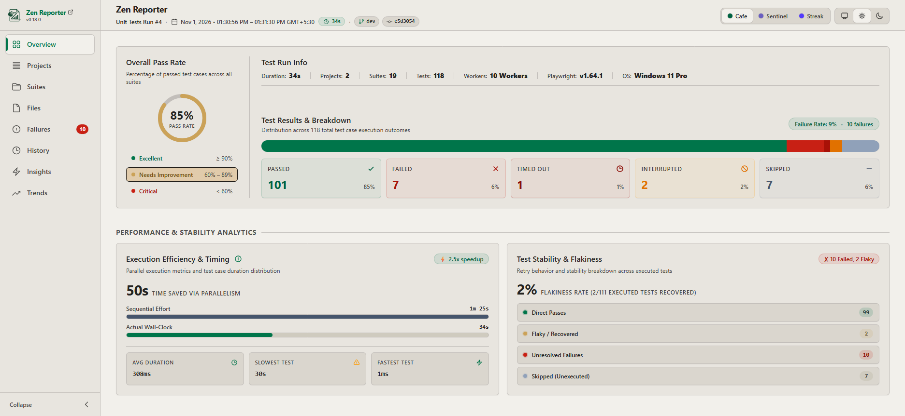
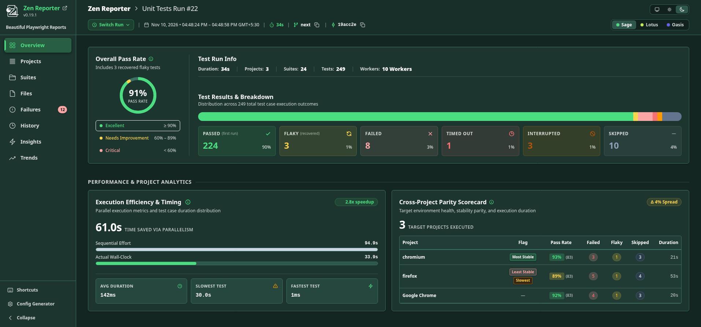

# Zen Reporter

[](https://www.npmjs.com/package/@arpanp/zen-reporter)
[](https://www.npmjs.com/package/@arpanp/zen-reporter)
[](LICENSE)

Beautiful test execution reports for Playwright.

[🚀 Live Demo](https://zen-reporter.vercel.app/demo) | [📚 Documentation](https://zen-reporter.vercel.app) | [📦 NPM Package](https://www.npmjs.com/package/@arpanp/zen-reporter)

[📝 Release Notes](https://github.com/apatelia/zen-reporter/releases) | [🐛 Report an Issue](https://github.com/apatelia/zen-reporter/issues)

Zen Reporter transforms Playwright's raw test results into an interactive, visually stunning dashboard. It provides a clean, modern interface for exploring test suites, analyzing pass/fail rates, and diving into individual test failures with full step-by-step execution traces, source code snippets, syntax highlighting, and error stacks.

Light mode:



Dark mode:



## Features

- **High-Level Test Dashboard**: Visual summary metrics featuring pass rate radial indicators (with dual-tone arcs and flakiness warnings when tests pass via retries), execution efficiency, cross-project parity and stability scorecard (highlighting pass rate delta spread, slowest projects, and target environment parity), test run details (duration, Git branch & commit hash with one-click copy and toast notifications, projects, suites, test counts, worker threads, Playwright version, operating system), and calculation tooltips.
- **Header Run Switcher**: Quick-switch dropdown in the top navigation bar to seamlessly toggle between recent historical runs without leaving the active view, complemented by the full historical run switcher modal (`/`).
- **Per-Project Execution Analytics**: Detailed status bar charts, volume and coverage distribution, and project detail cards comparing Playwright project profiles.
- **Suite & Spec File Explorer**: Interactive, searchable tree view container for nested `describe` suites with collapsible nodes, bulk expand/collapse controls, retry badges, test case cards, and paginated spec file summary tables.
- **Deep-Dive Failure Analysis**: Detailed root cause analysis with two grouping modes (file grouping and error signature clustering to group identical root causes into Shared Issue clusters), step-by-step execution traces with target indicators (`▶`), source code snippets with syntax highlighting, diff stack traces (`Expected` vs `Received`), and retry attempt tabs (`Run`, `Retry #1`).
- **Visual Regression Diff Viewer**: Built-in side-by-side snapshot comparison for visual regression testing, allowing interactive comparison of `actual`, `expected` (baseline), and overlay `diff` image attachments.
- **Execution History Archiving**: Archive historical test runs with details on run metadata, execution modes (`Parallel, N workers` vs `Serial`), wall-clock duration, pass/fail ratios, and automated quality ratings (`Excellent`, `Needs improvement`, `Critical`).
- **File & Test Case History**: Dedicated **File History** and **Test History** views to analyze long-term spec file stability, individual test case pass/fail rates, run counts, average execution durations, date-range filtering, and text search across historical runs.
- **Export to CSV**: Lightweight, UTF-8 CSV exporter for all report tables (Files, History, Insights). Respects active filters/date ranges and exports un-paginated full datasets for easy data sharing and external analysis.
- **Visual Quality Trends**: Track pass rate percentages over time, multi-project execution duration trends per project profile, and step category trends across historical runs.
- **Dual History & Multi-Cloud Architecture**:
  - **Local Mode (SQLite & Disk)**: Single-developer and local CI environments store execution history in embedded SQLite (`history.db`) and artifacts on disk.
  - **Remote SaaS Mode (Postgres & Multi-Cloud Object Storage)**: Ingestion server (`@arpanp/zen-server`) streaming test runs into PostgreSQL with direct binary uploads via presigned URLs to **AWS S3** (or MinIO/R2), **Google Cloud Storage (GCS)**, and **Microsoft Azure Blob Storage**.
- **DuckDB-Powered Test Intelligence**: Embedded analytics engine for advanced test suite intelligence:
  - **Flaky Intelligence**: Detect tests fluctuating between pass and fail across historical runs.
  - **Regression Tracking**: Identify tests that previously passed but regressed to failed in the latest run.
  - **Slowest Tests Analysis**: Rank top slowest test cases by average execution duration across runs.
  - **P95 Duration & Latency**: Analyze 95th percentile completion thresholds per project profile.
- **Core Platform Capabilities**:
  - **Interactive Configuration Generator**: Built-in visual Playwright configuration generator accessible right from the sidebar footer. Easily adjust reporter options, explore history modes (Local SQLite vs Remote SaaS), preview syntax-highlighted TypeScript/JavaScript configuration diffs in real-time with modified property indicators, and copy directly to `playwright.config.ts` or `playwright.config.js`.
  - **Keyboard Navigation & Hotkeys**: Full single-key shortcuts for rapid dashboard navigation (`1-8` for tabs, `[`/`]` for cycling, `/` for run switcher, `x`/`s` for expanding/collapsing suites & failures, `f` for search focus, `p`/`n` for table & attachment pagination, `d` for dark mode, `t` for themes, `r` for back-to-top, and `?` for the interactive cheat-sheet). See the complete [Keyboard Shortcuts Guide](docs/keyboard-shortcuts.md).
  - **Themes & Dark Mode**: Multiple design themes (`Sage`, `Lotus`, `Oasis`) with light, dark, and auto system mode toggles (following OS preferences), built with WCAG-compliant color tokens and configurable default states.
  - **Self-Contained Report Bundle Output**: Generates an interactive HTML dashboard (`index.html`) backed by local SQLite execution history (`history.db`) and test attachments (`attachments/`) for easy CI/CD artifact storage. Optionally creates a lightweight standalone `summary.html` dedicated to executive dashboards.

> **Note**: Designed and built with AI pair-programming tools; fully tested, maintained, and quality-assured by human hands.

---

> **Compatibility**: Zen Reporter is designed for standard Playwright test suites and does not support BDD-styled tests (e.g. Cucumber / `playwright-bdd`).

## Installation

```bash
npm install @arpanp/zen-reporter
```

---

## Configuring Zen Reporter in Playwright

Add `@arpanp/zen-reporter` to your `playwright.config.ts` (or `playwright.config.js`):

### Basic Configuration

```ts
import { defineConfig } from '@playwright/test';

export default defineConfig({
  reporter: '@arpanp/zen-reporter',
});
```

### Configuration

You can customize Zen Reporter using Playwright's reporter tuple syntax:

```ts
import { defineConfig } from '@playwright/test';

export default defineConfig({
  reporter: [
    [
      '@arpanp/zen-reporter',
      {
        outputDir: 'zen-report', // Output directory for reports and SQLite history
        projectName: 'My E2E Project', // Project name displayed in top navigation bar
        theme: 'Sage', // Initial visual theme: 'Sage' | 'Lotus' | 'Oasis'
      },
    ],
  ],
});
```

> ⚙️ **Full Configuration Guide**: For all available options (`singleSummaryFile`, `minimalReport`, `enableHistory`, `consoleProgress`, `openAutomatically`), production recipes, and remote SaaS setup, see the [Configuration Guide](docs/configuration.md).
>
> 💡 **Visual Config Generator**: You can also configure all options interactively in the web dashboard! Click **Config Generator** at the bottom of the sidebar to tune settings and copy the generated snippet directly into your config file.

### Report Output Structure

When executed, Zen Reporter generates a self-contained report folder (default: `zen-report/`) with the following directory structure:

```text
zen-report/
├── index.html        # Main interactive HTML dashboard interface
├── summary.html      # Optional standalone executive summary dashboard (when singleSummaryFile: true)
├── summary.json      # Optional pruned executive summary dataset (when singleSummaryFile: true)
├── history.db        # SQLite history database tracking all historical runs, test executions & metrics
├── attachments/      # Extracted test attachments (screenshots, videos, trace files, text logs)
└── runs/             # (Legacy / JSONL mode) Historical per-run JSONL execution logs
```

> **Note**: To ensure historic trends, run logs, and media attachments render correctly, archive or publish the complete `zen-report/` directory in your CI/CD pipeline artifacts. SQLite (`history.db`) is used by default for local execution history; legacy `.jsonl` runs can be migrated seamlessly using `npx zr history migrate --clean`.

---

## Usage

### 1. Running Tests

Run your Playwright tests as usual. Zen Reporter will stream live progress directly to your console (`line` mode in interactive terminals or `dot` mode in non-TTY environments) with intuitive retry tracking (`🔁 [RETRYING]`, `🔄 [FLAKY]`, `❌ [FAILED]`) and display a comprehensive ASCII summary table upon test completion (highlighting Status, Duration, Pass Rate, Total, Passed, Flaky, Failed, Timed Out, Interrupted, and Skipped counts):

```bash
npx playwright test
```

#### Running Tests in Shard Mode

Running tests across multiple shards in CI or locally? Follow our [Sharded Test Runs Guide](docs/sharding.md) to generate a single consolidated Zen Report and unified execution history across all shards.

### 2. Viewing the Generated Report

Launch the built-in report server to open the interactive dashboard in your browser using `npx zr show`:

```bash
npx zr show
```

### 3. Using the Interactive Configuration Generator

Zen Reporter comes with an interactive Playwright Configuration Generator built right into the report dashboard:

- **Launch from Sidebar**: Click the **Config Generator** button located at the bottom of the left navigation sidebar.
- **Inspect & Tune Settings**: Modify report options (project names, run title format patterns, initial theme, dark mode state, standalone summaries, console tickers, and local SQLite vs remote SaaS history modes).
- **Track Modified Settings**: Changed settings from the currently active report configuration are highlighted with subtle indicator dots, and changed configuration lines in the preview panel are color-accented.
- **Copy Ready-to-Use Snippets**: Toggle between `playwright.config.ts` and `playwright.config.js` and click **Copy** to drop the new configuration straight into your codebase.

### 4. CLI Commands Reference (`zr`)

Zen Reporter includes a built-in CLI executable (`npx zr`) for serving reports, querying historical test intelligence, and managing SQLite storage:

#### Interactive Menu Mode

Running `npx zr` without arguments in an interactive terminal launches a guided, menu-driven experience powered by `@clack/prompts`:

```bash
npx zr
```

- Navigate commands, history analytics, and database cleanups using arrow keys and `Enter`.
- Supports interactive table pagination (`Next 25`, `Show All`, `Export All to CSV`, `Finish & Back`).
- Press `Esc` at any sub-prompt to safely step back or exit.

#### Direct Command Execution (Non-Interactive / CI)

Run specific subcommands directly in scripts or CI/CD pipelines:

```bash
# Report & Environment
npx zr show                          # Launch local report server
npx zr summary                       # Output Markdown summary for PR comments
npx zr env                           # Diagnostic environment details

# History Intelligence & Analytics
npx zr history                       # List historical runs
npx zr history flaky                 # List flaky tests
npx zr history slow --limit 10       # Top 10 slowest tests across runs
npx zr history trend                 # Historical pass rate trends over time
npx zr history flaky --export        # Export dataset to RFC 4180 CSV file

# SQLite Database Maintenance
npx zr history clean --keep 50       # Retain latest 50 runs, purging older runs
npx zr history vacuum                # Reclaim unused disk space with VACUUM
npx zr history migrate --clean       # Migrate legacy .jsonl runs into SQLite
```

> 📖 **Full CLI Documentation**: For all subcommands, interactive menu workflows, SQL query examples (`zr history query`), and complete flag matrices, see the [CLI Reference Guide](docs/cli.md).
