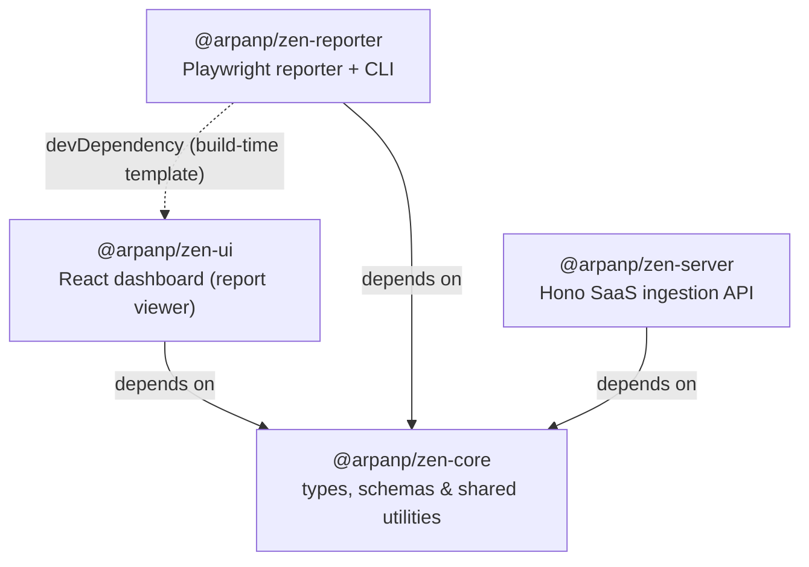
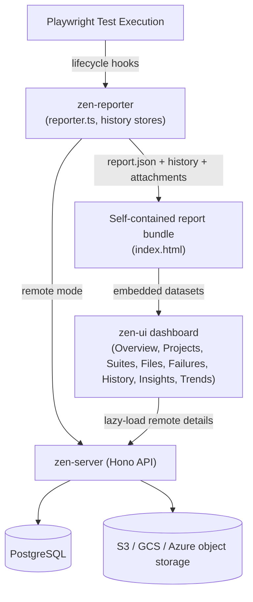

# Project Structure & Architecture

Zen Reporter is a **multi-package monorepo** (npm workspaces). The root `package.json` (`zen-reporter-monorepo`) owns the workspaces config, shared
lint/test/format scripts, and the Playwright test configuration. All runtime code lives under `packages/`.

```text
zen-reporter/
├── package.json               # Monorepo root (npm workspaces: packages/*)
├── playwright.config.ts       # Playwright config for the repo's own test suite
├── tests/                     # Playwright specs for Zen Reporter itself
├── zen-report/                # Generated self-contained report bundle output
└── packages/
    ├── core/                  # @arpanp/zen-core      → see [core](packages/core.md)
    ├── ui/                    # @arpanp/zen-ui        → see [ui](packages/ui.md)
    ├── reporter/              # @arpanp/zen-reporter  → see [reporter](packages/reporter.md)
    └── server/                # @arpanp/zen-server    → see [server](packages/server.md)
```

---

## Package Dependency Graph

The packages form a **star topology** — every package's runtime dependency is
only `@arpanp/zen-core`, which has no internal dependencies. The one addition:
`zen-reporter` declares `zen-ui` as a **devDependency** purely for the
build-time template copy (it never imports it at runtime):



### Package Overview

| Package                | Role                                                                                                                           | Depends on                                                          | Built with                  |
| :--------------------- | :----------------------------------------------------------------------------------------------------------------------------- | :------------------------------------------------------------------ | :-------------------------- |
| `@arpanp/zen-core`     | Shared domain types, report/history schemas, and pure utility functions (CSV export, formatting, stats, theming, highlighting) | —                                                                   | `tsc` (ESM + CJS dual emit) |
| `@arpanp/zen-ui`       | Interactive HTML report dashboard; single-file Vite/React bundle with all UI tabs                                              | `zen-core`                                                          | `vite`                      |
| `@arpanp/zen-reporter` | Playwright reporter lifecycle, history persistence (SQLite / remote SaaS), report bundle generation, and the `zr` CLI          | `zen-core` (runtime); `zen-ui` (devDependency, build-time template) | `vite` + `tsc`              |
| `@arpanp/zen-server`   | Multi-tenant Hono API for run ingestion, PostgreSQL persistence, and multi-cloud (S3/GCS/Azure) attachment storage             | `zen-core`                                                          | `tsc`                       |

> **Note:** `zen-reporter` consumes the built UI bundle as a build-time asset:
> `zen-ui` is declared as a devDependency, and `build:template`
> (`scripts/copy-template.mjs`) copies `index.html` + `favicon-*.svg` from the
> resolved `zen-ui` package into the reporter's `dist/`. It is never imported
> at runtime. Build order: `core → ui → reporter → server`
> (root script: `npm run build`).

---

## High-Level Data Flow



- **Local mode:** the reporter writes `report.json`, SQLite `history.db`, and
  attachment files next to the generated `index.html`. The UI renders from
  datasets inlined into that single HTML file. See [reporter](packages/reporter.md).
- **Remote mode:** `RemoteHistoryStore` (in the reporter) uploads attachments
  directly to cloud storage via presigned URLs and streams run metadata to the
  server. The UI lazily fetches heavy test details from the server. See
  [server](packages/server.md) and [reporter](packages/reporter.md).

---

## Detailed Package Documentation

- [`packages/core.md`](packages/core.md) — shared types, schemas & utilities
- [`packages/ui.md`](packages/ui.md) — dashboard architecture, tabs & components
- [`packages/reporter.md`](packages/reporter.md) — reporter lifecycle, CLI & data flow
- [`packages/server.md`](packages/server.md) — backend API, storage & REST reference
