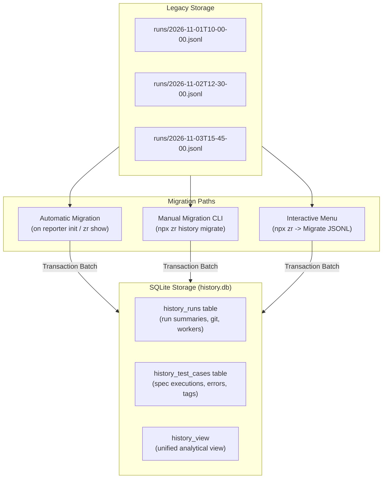

# JSONL to SQLite History Migration Guide

This guide details how Zen Reporter migrates historical test run data from legacy newline-delimited JSON (`.jsonl`) files into SQLite (`history.db`). It covers the architectural rationale, automatic migration on reporter startup, manual migration using the `zr history migrate` CLI command, interactive migration via the `zr` menu, error handling, and verification.

---

## Background & Architecture

In earlier versions of Zen Reporter, historical test runs were stored as individual `.jsonl` files under `<outputDir>/runs/*.jsonl`. While simple, per-run files posed several challenges at scale:

- High filesystem I/O and directory traversal latency when scanning dozens or hundreds of runs.
- Lack of indexed queries for analytical metrics (flakiness detection, regression tracking, duration percentiles).
- Inefficient artifact archival in CI/CD pipelines.

Zen Reporter transitioned to an embedded SQLite database (`history.db`) utilizing Node's built-in `node:sqlite` module (Node.js >= 22.5.0) with WAL (Write-Ahead Logging) mode. To ensure a seamless upgrade path, Zen Reporter provides both **automatic** and **manual** migration mechanisms.



---

## 1. Automatic Migration

Zen Reporter performs automatic migrations silently in the background when initializing local SQLite storage.

### How It Works

1. When `@arpanp/zen-reporter-playwright` runs at the end of a Playwright test run (or when launching `npx zr show`), `SqliteHistoryStore` initializes.
2. It checks if a legacy `runs/` directory exists immediately adjacent to `history.db` (e.g., `<outputDir>/runs`).
3. If `.jsonl` files are found:
   - Existing run IDs in `history_runs` are retrieved to avoid duplicate insertions.
   - Any un-migrated `.jsonl` files are parsed and inserted into `history_runs` and `history_test_cases` inside a single atomic SQLite transaction.
   - Upon completion, Zen Reporter displays an informational console notice:

     ```text
     ℹ Zen Reporter: Successfully migrated 5 historical run(s) (120 test executions) to SQLite (zen-report/history.db).
     💡 You may safely remove the legacy "zen-report/runs" directory or run "npx zr history migrate --clean".
     ```

4. Source `.jsonl` files are **preserved** by default during automatic migration to avoid unexpected data loss.

### Disabling Automatic Migration

If you manage migrations explicitly via CLI or scripts, you can disable automatic migration in your Playwright configuration:

```typescript
// playwright.config.ts
import { defineConfig } from '@playwright/test';

export default defineConfig({
  reporter: [
    [
      '@arpanp/zen-reporter-playwright',
      {
        outputDir: 'zen-report',
        historyOptions: {
          autoMigrate: false, // Disables automatic legacy JSONL migration on reporter init
        },
      },
    ],
  ],
});
```

---

## 2. Manual Migration via CLI (`zr history migrate`)

The `zr history migrate` command provides explicit control over the migration process and allows optional cleanup of legacy files.

### Syntax

```bash
npx zr history migrate [options]
```

### Options

| Flag               | Description                                                                                         |
| :----------------- | :-------------------------------------------------------------------------------------------------- |
| `--clean`          | Deletes the source `.jsonl` files from disk after they are successfully migrated into `history.db`. |
| `-d, --dir <path>` | Custom output directory containing `history.db` and the `runs/` subfolder (default: `zen-report`).  |

### Examples

#### Standard Migration (Preserve Source Files)

Run migration without deleting legacy files:

```bash
npx zr history migrate
```

**Output:**

```text
Migrating historical JSONL runs to SQLite (zen-report/history.db)...
✓ Migrated 12 runs (450 test executions) in 48ms. Skipped 3 already migrated runs.
```

#### Migration with Cleanup (`--clean`)

Migrate legacy records and automatically delete the source `.jsonl` files once saved:

```bash
npx zr history migrate --clean
```

**Output:**

```text
Migrating historical JSONL runs to SQLite (zen-report/history.db)...
✓ Migrated 12 runs (450 test executions) in 48ms. Skipped 3 already migrated runs.
✓ Cleaned up source JSONL files.
```

#### Custom Report Directory

If your reports are stored in a non-default directory (such as `test-results/report`):

```bash
npx zr history migrate --dir test-results/report --clean
```

---

## 3. Interactive Migration via Menu

If you prefer terminal-driven menus, you can execute the migration interactively:

1. Launch the interactive CLI menu:

   ```bash
   npx zr
   ```

2. Use arrow keys to select **Manage History**:

   ```text
   ◆ Select action:
     View Report
   │ Manage History
     Show Config
     Exit
   ```

3. Choose **Migrate JSONL**:

   ```text
   ◆ History Action:
     List Runs
     Clean History
   │ Migrate JSONL (Migrate legacy .jsonl runs into SQLite)
     Vacuum Database
     Export to CSV
     ← Back
   ```

4. Confirm whether you want to delete source `.jsonl` files when prompted:

   ```text
   ◆ Delete source JSONL files after successful migration? (Esc to go back)
   │ ● No (Keep files)
     ○ Yes (Delete files)
   ```

---

## Schema Mapping Reference

During migration, each JSONL record line is parsed and mapped directly to SQLite relational tables:

### 1. Run Summary (`history_runs`)

The first row of each `.jsonl` file represents run-level aggregate metrics:

| JSONL Field                  | SQLite Column (`history_runs`) | Type               | Default / Fallback    |
| :--------------------------- | :----------------------------- | :----------------- | :-------------------- |
| `run_id`                     | `run_id`                       | `TEXT PRIMARY KEY` | Required              |
| `run_name`                   | `run_name`                     | `TEXT`             | `'Test Run'`          |
| `project_name`               | `project_name`                 | `TEXT`             | `'Project'`           |
| `started_at`                 | `started_at`                   | `TEXT`             | Current ISO Timestamp |
| `ended_at`                   | `ended_at`                     | `TEXT`             | Current ISO Timestamp |
| `run_duration_ms`            | `run_duration_ms`              | `INTEGER`          | `0`                   |
| `run_sequential_duration_ms` | `run_sequential_duration_ms`   | `INTEGER`          | `NULL`                |
| `run_total`                  | `run_total`                    | `INTEGER`          | `0`                   |
| `run_passed`                 | `run_passed`                   | `INTEGER`          | `0`                   |
| `run_flaky`                  | `run_flaky`                    | `INTEGER`          | `0`                   |
| `run_failed`                 | `run_failed`                   | `INTEGER`          | `0`                   |
| `run_skipped`                | `run_skipped`                  | `INTEGER`          | `0`                   |
| `run_timed_out`              | `run_timed_out`                | `INTEGER`          | `0`                   |
| `run_interrupted`            | `run_interrupted`              | `INTEGER`          | `0`                   |
| `run_workers`                | `run_workers`                  | `INTEGER`          | `NULL`                |
| `run_projects`               | `run_projects`                 | `INTEGER`          | `1`                   |
| `step_assertions`            | `step_assertions`              | `INTEGER`          | `0`                   |
| `step_actions`               | `step_actions`                 | `INTEGER`          | `0`                   |
| `step_network`               | `step_network`                 | `INTEGER`          | `0`                   |
| `step_hooks`                 | `step_hooks`                   | `INTEGER`          | `0`                   |
| `step_waits`                 | `step_waits`                   | `INTEGER`          | `0`                   |
| `step_others`                | `step_others`                  | `INTEGER`          | `0`                   |
| `git_branch`                 | `git_branch`                   | `TEXT`             | `NULL`                |
| `git_commit`                 | `git_commit`                   | `TEXT`             | `NULL`                |
| `git_commit_full`            | `git_commit_full`              | `TEXT`             | `NULL`                |
| `playwright_version`         | `playwright_version`           | `TEXT`             | `NULL`                |
| `os_name`                    | `os_name`                      | `TEXT`             | `NULL`                |

### 2. Test Case Executions (`history_test_cases`)

Subsequent rows in the `.jsonl` file represent individual test cases:

| JSONL Field       | SQLite Column (`history_test_cases`) | Type      | Default / Fallback               |
| :---------------- | :----------------------------------- | :-------- | :------------------------------- |
| `run_id`          | `run_id`                             | `TEXT`    | Parent `run_id` (foreign key)    |
| `file`            | `file`                               | `TEXT`    | `''`                             |
| `suite`           | `suite`                              | `TEXT`    | `''`                             |
| `title`           | `title`                              | `TEXT`    | `''`                             |
| `project`         | `project`                            | `TEXT`    | `''`                             |
| `status`          | `status`                             | `TEXT`    | `'passed'`                       |
| `duration_ms`     | `duration_ms`                        | `INTEGER` | `0`                              |
| `attempts`        | `attempts`                           | `INTEGER` | `1`                              |
| `failed_attempts` | `failed_attempts`                    | `INTEGER` | `0`                              |
| `passed_on_retry` | `passed_on_retry`                    | `INTEGER` | `1` if passed on retry, else `0` |
| `error_message`   | `error_message`                      | `TEXT`    | `NULL`                           |
| `error_stack`     | `error_stack`                        | `TEXT`    | `NULL`                           |
| `error_file`      | `error_file`                         | `TEXT`    | `NULL`                           |
| `error_line`      | `error_line`                         | `INTEGER` | `NULL`                           |
| `tags`            | `tags`                               | `TEXT`    | Serialized JSON string or `NULL` |

---

## Verifying the Migration

After migration completes, you can verify your historical data using the `zr history` subcommands:

1. **List Migrated Runs**:

   ```bash
   npx zr history list
   ```

   Displays a formatted table of all historical runs now registered in `history.db`.

2. **Inspect Migration via SQL**:

   ```bash
   npx zr history query "SELECT count(*) AS total_runs FROM history_runs"
   npx zr history query "SELECT count(*) AS total_tests FROM history_test_cases"
   ```

3. **Reclaim Database Storage (Optional)**:
   If you performed a large batch migration and cleaned up records, run `vacuum` to optimize the SQLite database file:

   ```bash
   npx zr history vacuum
   ```

---

## Troubleshooting & FAQ

### Are duplicate runs re-imported if I run migration twice?

No. Zen Reporter checks existing run IDs before importing. If a run ID from a `.jsonl` file already exists in `history_runs`, it is skipped. When using `--clean`, already-migrated `.jsonl` files are safely deleted.

### What happens if a JSONL file is malformed?

In Zen Reporter's legacy JSONL format, every record is a flattened test execution row containing both run-level metadata (`run_id`, `run_name`, `started_at`, etc.) and test case fields. The migration parser handles malformed rows with line-by-line recovery:

- **Corrupted line 1**: The parser logs a warning for line 1 and continues scanning subsequent lines in the file for the first valid record containing a `run_id`. Once found, it creates the `history_runs` record and imports all valid test cases from the remaining lines.
- **Corrupted test execution line**: Emits a warning identifying the filename, line number, `run_id`, and parser error (e.g. `⚠ [history migrate] Corrupted JSON line in "run-1.jsonl" (line 42, run_id: "2026-11-01T10-00-00"): ... Skipping line.`), skipping that specific line while continuing to migrate remaining valid test cases in the run.
- **Entire file corrupted**: If no line in the file can be parsed or contains a valid `run_id`, a warning is logged (`⚠ [history migrate] Could not find any valid test record with a run_id in "<file>". Skipping entire file.`) and the file is preserved on disk without interrupting the batch transaction.
- **Database error**: If an unexpected database-level error occurs, the entire batch transaction is rolled back safely via `ROLLBACK TRANSACTION`.

### Does this migrate test attachments or video recordings?

Binary attachments (screenshots, videos, trace files) reside in `<outputDir>/attachments/` and are not stored directly inside JSONL files. Their relative file paths are recorded in SQLite, and disk files remain accessible directly by the report dashboard and viewer.
