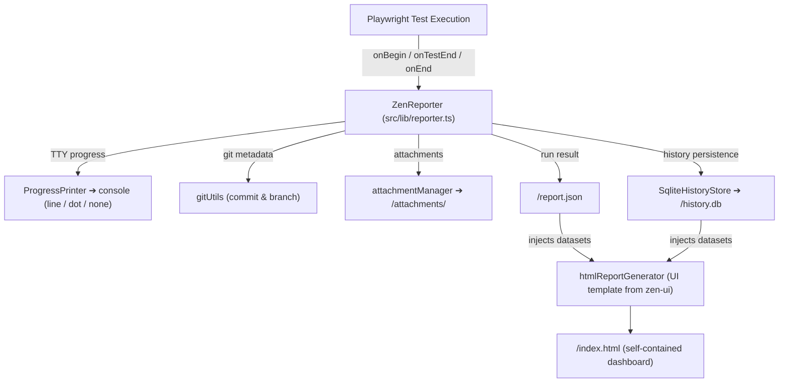

# `@arpanp/zen-reporter-playwright` — Playwright Reporter Adapter

> Package: `packages/reporter-playwright` · Runtime deps: `@arpanp/zen-core`, `@arpanp/zen-cli` · Dev dep: `@arpanp/zen-ui` (build-time template only) · Entry: `dist/reporter.cjs`

The official Playwright reporter adapter for Zen Reporter. It plugs into Playwright as a custom reporter,
processes test execution data, persists run history via `@arpanp/zen-cli`, and generates the
self-contained HTML report bundle.

---

## Source Layout

```text
packages/reporter-playwright/
├── src/
│   └── lib/
│       ├── reporter.ts          # Playwright reporter lifecycle orchestrator (onBegin, onTestEnd, onEnd)
│       ├── progressPrinter.ts   # TTY console progress rendering ('line' | 'dot' | 'none')
│       ├── attachmentManager.ts # Attachment extraction, MIME resolution & disk persistence
│       ├── dataProcessor.ts     # Raw data conversion, duration calculation & package manager detection
│       └── htmlReportGenerator.ts # Loads the UI template, injects JSON datasets, emits report
├── vite.reporter.config.ts    # Vite build for the reporter bundle
└── tsconfig.lib.json
```

---

## Reporter Data Flow (Local Mode)



```text
Playwright Test Execution
  hooks: onBegin ➔ onTestBegin ➔ onTestEnd ➔ onEnd
    ├── TTY Progress  ➜ ProgressPrinter
    ├── Attachments   ➜ attachmentManager
    ├── Git Metadata  ➜ gitUtils
    └── History       ➜ HistoryStore (SQLite local / RemoteHistoryStore SaaS)
            │
            ▼
  <outputDir>/report.json (+ history.db, attachments/)
            │
            ▼
  htmlReportGenerator
  inlines report.json & history.json into <script id="report-data">
            │
            ▼
  <outputDir>/index.html  ➜  `zr show` serves it on 127.0.0.1
```

### Remote (SaaS) Mode

`RemoteHistoryStore` replaces the local SQLite store: it requests presigned
upload URLs from `@arpanp/zen-server`, PUTs attachment binaries directly to
S3/GCS/Azure object storage, and streams lightweight run metadata to the
PostgreSQL-backed ingestion API. See [server.md](server.md).

---

## Build Pipeline

```bash
npm run build -w @arpanp/zen-reporter-playwright
```

1. **`build:template`** — copies the data-free UI bundle
   (`packages/ui/dist/index.html`) into the reporter's `dist/`.
2. **`build:reporter`** — Vite-bundles the reporter entry (`dist/reporter.js`/`.cjs`)
   and emits type declarations via `tsc -p tsconfig.lib.json`.

Build order from the monorepo root: `core → reporter (bundle) → ui →
reporter (template) → server` (`npm run build`). The reporter is bundled
before the UI because the UI's `vite.config.ts` imports `@arpanp/zen-reporter-playwright`,
which resolves through the reporter's `dist/`; the template copy then runs
after the UI build.

---

## CLI (`zr`)

The `bin/zen-reporter.js` entry (published as `zr` / `zen-reporter`) launches an
interactive menu or a direct command: `zr show`, `zr history ...`,
`zr summary`, `zr env`, `zr help`. See [cli.md](../cli.md).
