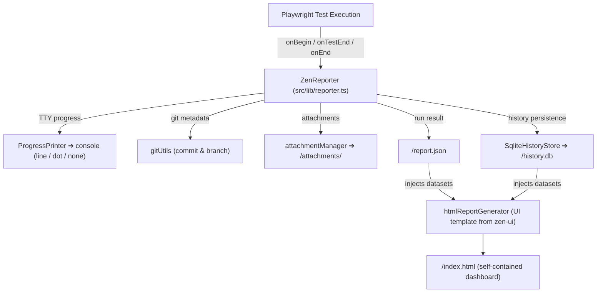

# `@arpanp/zen-reporter` — Playwright Reporter & CLI

> Package: `packages/reporter` · Deps: `@arpanp/zen-core` (+ `zen-ui` as a build-time template) · Entry: `dist/reporter.cjs`

The core of Zen Reporter. It plugs into Playwright as a custom reporter,
processes test execution data, persists run history, generates the
self-contained HTML report bundle, and ships the `zr` CLI.

---

## Source Layout

```text
packages/reporter/
├── bin/
│   ├── zen-reporter.js          # Executable CLI entry ('zr' / 'zen-reporter')
│   └── commands/
│       ├── common.js            # Shared CLI helpers, ANSI table formatting & DuckDB loader
│       ├── menu.js              # Interactive Clack-powered menu & navigation router
│       ├── show.js              # Local 127.0.0.1 static HTTP report server ('zr show')
│       ├── history.js           # History report & query engine ('zr history ...')
│       ├── summary.js           # Markdown summary snippet generator ('zr summary')
│       ├── env.js               # System environment diagnostics ('zr env')
│       ├── help.js              # Help & usage documentation renderer
│       ├── system.js            # OS name & package version resolution
│       └── system.d.ts
├── src/
│   └── lib/
│       ├── reporter.ts          # Playwright reporter lifecycle orchestrator (onBegin, onTestEnd, onEnd)
│       ├── progressPrinter.ts   # TTY console progress rendering ('line' | 'dot' | 'none')
│       ├── attachmentManager.ts # Attachment extraction, MIME resolution & disk persistence
│       ├── dataProcessor.ts     # Raw data conversion, duration calculation & package manager detection
│       ├── gitUtils.ts          # Git commit/branch resolution (CI env + local `git rev-parse`)
│       ├── htmlReportGenerator.ts # Loads the UI template, injects JSON datasets, emits report
│       ├── runHistory.ts        # Run identifier builder & analytics row flattening
│       ├── runHistoryWriter.ts  # Self-contained per-run JSONL persistence under <outputDir>/runs/
│       └── history/
│           ├── HistoryStore.ts      # Storage interface for test run persistence
│           ├── SqliteHistoryStore.ts # SQLite implementation (tables ➔ migrations ➔ indexes ➔ views)
│           ├── RemoteHistoryStore.ts # Remote SaaS ingestion client (presigned uploads)
│           ├── schema.ts            # Relational DDL definitions
│           ├── migration.ts         # Legacy JSONL ➔ SQLite migration handler
│           └── index.ts
├── vite.reporter.config.ts    # Vite build for the reporter bundle
└── tsconfig.lib.json
```

---

## Reporter Data Flow (Local Mode)



```text
Playwright Test Execution
  hooks: onBegin ➔ onTestBegin ➔ onTestEnd ➔ onEnd
    ├── TTY Progress  ➜ ProgressPrinter
    ├── Attachments   ➜ attachmentManager
    ├── Git Metadata  ➜ gitUtils
    └── History       ➜ HistoryStore (SQLite local / RemoteHistoryStore SaaS)
            │
            ▼
  <outputDir>/report.json (+ history.db, attachments/)
            │
            ▼
  htmlReportGenerator
  inlines report.json & history.json into <script id="report-data">
            │
            ▼
  <outputDir>/index.html  ➜  `zr show` serves it on 127.0.0.1
```

### Remote (SaaS) Mode

`RemoteHistoryStore` replaces the local SQLite store: it requests presigned
upload URLs from `@arpanp/zen-server`, PUTs attachment binaries directly to
S3/GCS/Azure object storage, and streams lightweight run metadata to the
PostgreSQL-backed ingestion API. See [server.md](server.md).

---

## Build Pipeline

```bash
npm run build -w @arpanp/zen-reporter
```

1. **`build:template`** — copies the data-free UI bundle
   (`packages/ui/dist/index.html`) into the reporter's `dist/`.
2. **`build:reporter`** — Vite-bundles the reporter entry (`dist/reporter.js`/`.cjs`)
   and emits type declarations via `tsc -p tsconfig.lib.json`.

Build order from the monorepo root: `core → ui → reporter → server`
(`npm run build`).

---

## CLI (`zr`)

The `bin/zen-reporter.js` entry (published as `zr` / `zen-reporter`) launches an
interactive menu or a direct command: `zr show`, `zr history ...`,
`zr summary`, `zr env`, `zr help`. See [cli.md](../cli.md).
