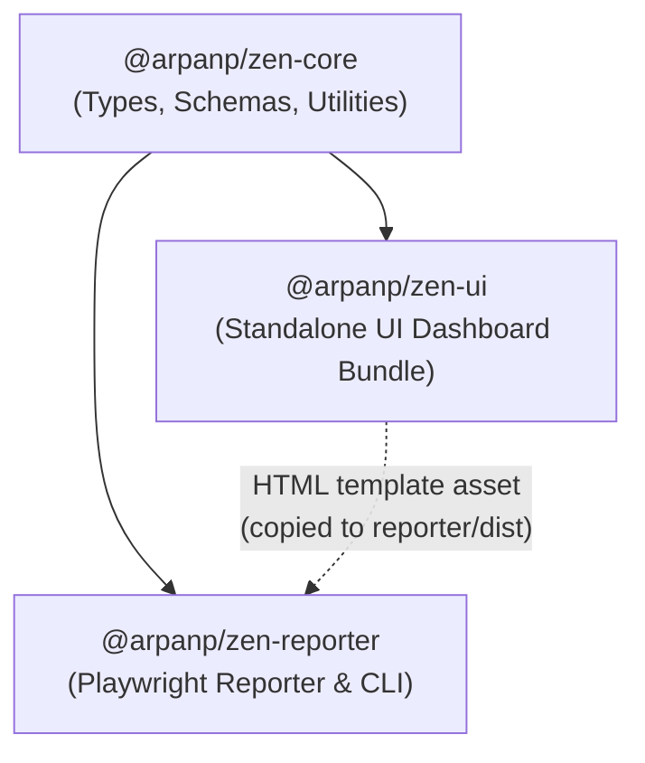

# Packaging and Release Workflow in Monorepo Structure

This document outlines how packaging, versioning, dependency management, CI/CD, and release workflows change following the refactoring of Zen Reporter into an npm workspaces monorepo architecture.

---

## 1. Overview of the Monorepo Structure

Zen Reporter has been restructured from a single monolithic package (`zen-reporter`) into three specialized packages under the `@arpanp` npm scope, coordinated by npm workspaces at the repository root:

```text
zen-reporter/                          (zen-reporter-monorepo: private root)
├── packages/
│   ├── core/                          (@arpanp/zen-core)
│   │   ├── src/                       (shared types, classifiers, formatters, stats)
│   │   ├── dist/                      (ESM & CJS dual emit)
│   │   └── package.json
│   ├── ui/                            (@arpanp/zen-ui)
│   │   ├── src/                       (React dashboard, charts, modals, toast)
│   │   ├── dist/                      (Single-file HTML bundle + favicon)
│   │   └── package.json
│   └── reporter/                      (@arpanp/zen-reporter)
│       ├── bin/                       (CLI commands: zr, zen-reporter)
│       ├── src/                       (Playwright reporter, SQLite history, migration)
│       ├── dist/                      (Reporter library + bundled template HTML)
│       └── package.json
├── plan/                              (Architecture, test plans, roadmaps)
├── tests/                             (Root-level end-to-end and integration specs)
└── package.json                       (Workspaces coordinator & verification hub)
```

---

## 2. Before vs. After: Architecture & Packaging Comparison

| Dimension                  | Previous Monolithic Architecture (`<= v0.19.1`)  | Refactored Monorepo Architecture (`> v0.19.1`)                                                                 |
| :------------------------- | :----------------------------------------------- | :------------------------------------------------------------------------------------------------------------- |
| **Published Package(s)**   | Single package: `zen-reporter`                   | Modular packages: `@arpanp/zen-core`, `@arpanp/zen-reporter`, (and optionally `@arpanp/zen-ui`)                |
| **Root Package**           | Was the publishable package itself               | `private: true` monorepo coordinator                                                                           |
| **Build Dependency Order** | Single `npm run build`                           | Strict sequential DAG: `core` &rarr; `ui` &rarr; `reporter`                                                    |
| **Bundle Artifacts**       | UI output embedded directly in repo root `dist/` | UI built to `packages/ui/dist`, then copied into `packages/reporter/dist/index.html` during reporter packaging |
| **Inter-Package Linkage**  | Direct relative path imports (`../../lib/...`)   | Package name imports via npm workspaces (`@arpanp/zen-core`)                                                   |
| **CLI & Binaries**         | `bin/zen-reporter.js` at root                    | Exposed from `@arpanp/zen-reporter` package (`bin/zen-reporter.js`)                                            |
| **Publish Command**        | `npm publish` run once from root                 | Multi-package publish executed sequentially or targeted per package                                            |

---

## 3. Package Build Dependency Graph

The packages have a direct dependency hierarchy that dictates both the local build order and the release publish order:



### Sequential Build Steps

1. **`build:core` (`npm run build -w @arpanp/zen-core`)**: Compiles TypeScript interfaces, formatters, and metadata utilities into `packages/core/dist` (generating type definitions `.d.ts`).
2. **`build:ui` (`npm run build -w @arpanp/zen-ui`)**: Runs Vite in data-free single-file mode (`ZEN_REPORTER_DATA_FREE=true vite build`) to generate the production `dist/index.html` viewer.
3. **`build:reporter` (`npm run build -w @arpanp/zen-reporter`)**:
   - Copies `packages/ui/dist/index.html` into `packages/reporter/dist/index.html`.
   - Bundles the Playwright reporter library via `vite.reporter.config.ts`.
   - Compiles TypeScript declarations for the reporter library (`tsconfig.lib.json`).

The root script `npm run build` chains these three steps:

```bash
npm run build:core && npm run build:ui && npm run build:reporter
```

---

## 4. Release & Publishing Workflow Changes

Because root `package.json` is marked `"private": true`, running a simple `npm publish` from the repository root is no longer valid. Instead, the release pipeline must publish the individual packages.

### 4.1. Versioning Strategy Options

Two versioning models can be adopted:

#### Option A: Unified / Synchronized Versioning (Recommended)

All packages share the identical version number (`0.20.0`, `0.20.1`, etc.).

- **Pros**: Simple cognitive model; ensures complete compatibility across `@arpanp/zen-core` and `@arpanp/zen-reporter`.
- **Release Step**: Bump version simultaneously across root `package.json`, `packages/core/package.json`, `packages/ui/package.json`, and `packages/reporter/package.json`.

#### Option B: Independent Versioning

Each package versions according to SemVer independently.

- **Pros**: `@arpanp/zen-core` changes do not force major/minor bumps on `@arpanp/zen-reporter` unless breaking contracts change.
- **Cons**: Requires tooling like Changesets or Lerna to manage internal dependency ranges.

---

### 4.2. Updated GitHub Actions Publish Workflow (`.github/workflows/publish.yml`)

The publishing workflow must be updated to publish packages in order of their dependency graph:

1. **Publish `@arpanp/zen-core` first** so external consumers and registry resolution can satisfy dependencies.
2. **Publish `@arpanp/zen-reporter` second** with its dependencies resolved.
3. **(Optional) Publish `@arpanp/zen-ui`** if exposing standalone UI components or embedded viewers.

#### Example Updated GitHub Workflow

```yaml
name: Publish to npm

on:
  workflow_dispatch:
    inputs:
      npm_tag:
        description: 'npm tag (e.g. latest, beta, next)'
        required: true
        default: 'latest'
  release:
    types: [published]

permissions:
  contents: read
  id-token: write # Required for npm provenance (--provenance)

jobs:
  publish:
    runs-on: ubuntu-latest
    steps:
      - name: Checkout repository
        uses: actions/checkout@v6

      - name: Setup Node.js
        uses: actions/setup-node@v7
        with:
          node-version: 24
          registry-url: 'https://registry.npmjs.org'

      - name: Install dependencies
        run: npm ci

      - name: Code verification
        run: |
          npm run typecheck
          npm run lint
          npm run lint:unused
          npm run spellcheck
          npm run format:check

      - name: Build all packages
        run: npm run build

      - name: Publish @arpanp/zen-core
        run: |
          TAG="${{ github.event.inputs.npm_tag || 'latest' }}"
          npm publish -w packages/core --access public --tag "$TAG" --provenance

      - name: Publish @arpanp/zen-reporter
        run: |
          TAG="${{ github.event.inputs.npm_tag || 'latest' }}"
          npm publish -w packages/reporter --access public --tag "$TAG" --provenance
```

---

## 5. End-User Installation & Consumption Impact

### 5.1. Playwright Test Users

For consumers installing Zen Reporter into their test suites, the package name changes to `@arpanp/zen-reporter`:

```bash
# Installation
npm install --save-dev @arpanp/zen-reporter
```

#### Playwright Configuration (`playwright.config.ts`)

```typescript
import { defineConfig } from '@playwright/test';

export default defineConfig({
  reporter: [
    ['list'],
    [
      '@arpanp/zen-reporter',
      {
        outputFolder: 'zen-report',
        history: { mode: 'local' },
      },
    ],
  ],
});
```

#### CLI Invocation

```bash
npx zr show
# or
npx zen-reporter history report
```

### 5.2. Core Utility Consumers

Consumers wishing to build custom reporting tools, metrics dashboards, or analytics scripts can now import shared types and utilities directly without pulling in Playwright or UI dependencies:

```bash
npm install @arpanp/zen-core
```

```typescript
import type { HistoryRun, ReportData } from '@arpanp/zen-core';
import { formatDuration, getStatusBadgeColor } from '@arpanp/zen-core';
```

---

## 6. Local Development and Verification Invariants

When contributing changes in the monorepo, developers and automated agents must adhere to the following package script workflow:

1. **Dependency Resolution**: Always run `npm install` from the repository root so npm creates symlinks in `node_modules/@arpanp/*` pointing to `packages/*`.
2. **Workspace-Aware Verification**:
   - `npm run typecheck`: Runs `typecheck:core`, `typecheck:ui`, `typecheck:reporter`, and `typecheck:tests` across all workspaces.
   - `npm run lint`: Validates React, TypeScript, and markdown linting across all packages.
   - `npm run lint:unused`: Ensures 0 unused locals and parameters across packages.
   - `npm run spellcheck`: Validates documentation and codebase identifiers.
   - `npm run format:check` / `npm run format`: Verifies and applies code formatting.
3. **End-to-End Tests**: Run `npm test` from root. It executes Playwright tests against report generation and historical database behaviors using the compiled workspace outputs.

---

## 7. Migration Checklist for Future Releases

- [ ] Verify `package.json` in root has `"private": true`.
- [ ] Verify `packages/core/package.json` version matches release target.
- [ ] Verify `packages/reporter/package.json` dependency `"@arpanp/zen-core"` matches the release version tag.
- [ ] Verify all build artifacts (`packages/core/dist`, `packages/ui/dist`, `packages/reporter/dist`) are generated and populated by `npm run build`.
- [ ] Verify package manifests include proper `files: ["dist", "bin"]` restrictions so test fixtures and sources are omitted from the npm tarballs.
- [ ] Test local tarball pack generation with `npm pack -w packages/core` and `npm pack -w packages/reporter` to inspect payload size and manifest completeness.
